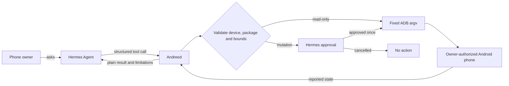

# Andreed — Android care that cannot silently take control

[](https://github.com/Agozie180/andreed/actions/workflows/tests.yml)
[](https://github.com/NousResearch/hermes-agent)
[](#measured-and-verified)
[](LICENSE)

| Judge link | Destination |
|---|---|
| Hermes catalog submission | [NousResearch/hermes-agent#153646](https://github.com/NousResearch/hermes-agent/pull/153646) |
| Standalone plugin source | [Agozie180/andreed](https://github.com/Agozie180/andreed) |
| Judge testing guide | [JUDGE_GUIDE.md](JUDGE_GUIDE.md) |
| Live-test self-audit | [AUDIT.md](AUDIT.md) |

> **The model may recommend an Android action, but it cannot invent the command or perform a mutation without the phone owner's explicit Hermes approval.**

Andreed is a deterministic Android device-care plugin for Hermes Agent. It turns
an owner-authorized phone into a structured, inspectable surface for storage,
data-use and app-state review, then offers a small set of focused actions with
guardrails enforced in code.

It does more than a prompt or skill can: Andreed registers five native Hermes
tools, runs validated ADB argument vectors, checks Android's reported state and
routes every mutation through Hermes's approval boundary.

## What we built

- A read-only doctor that proves ADB and the selected Android device are ready.
- A read-only scan that ranks third-party apps by available Android network
  counters, reports main-process state, storage pressure and existing policy.
- Approval-gated force-stop for one selected third-party package.
- Approval-gated metered background-data restriction with after-state
  verification.
- Approval-gated, bounded request for Android's device-wide cache trimming.

## Judging fit

Andreed is designed to be useful, reliable, polished and creative, with native
capabilities that a prompt or skill alone cannot provide.

| Criterion | Evidence in Andreed |
|---|---|
| Usefulness | Turns opaque Android storage, network-policy and app-state data into a focused review and three owner-approved care actions. |
| Reliability | Uses fixed argv-only subprocess calls, validates the exact device and package, refuses shared-UID policy changes, verifies policy after-state and covers the safety boundary with 16 tests. |
| Polish | Provides five typed native Hermes tools, structured JSON results, a doctor flow, copy-paste install/prompt instructions and CI across Windows, macOS and Linux. |
| Creativity | Makes Android's debugging surface useful without exposing a general phone controller, and turns the live OEM netstats failure into an explicit bounded fallback instead of hiding it. |
| Beyond a prompt or skill | Registers executable tools plus a `pre_tool_call` approval hook, invokes local ADB, reads real device state and verifies mutations—capabilities prose alone cannot provide. |

## How it works



The command path is intentionally narrow:

```text
User → Hermes tool schema → Andreed validation → Hermes approval → fixed ADB argv → Android
```

No raw command string or model-written shell code enters that path.

## The thesis, enforced—not asserted

| Hermes may decide | Andreed is structurally prevented from doing |
|---|---|
| Which focused tool to request | Executing a raw or model-written shell command |
| Which reported third-party app deserves review | Mutating a system package or malformed package name |
| Whether to recommend a restriction or force-stop | Performing the mutation before Hermes approval |
| How much cache space to request within bounds | Calling `pm clear`, uninstalling an app or deleting personal app data |
| How to explain Android's counters | Presenting unavailable metered data as measured zero |

The regression tests exercise these boundaries, including injection rejection,
ambiguous devices, shared UIDs, impossible trim targets and approval isolation.

## Measured and verified

| Claim | Evidence | Reproduce |
|---|---|---|
| Plugin behavior and safety boundaries | 16 mocked-device tests pass across 6 CI combinations: Windows, macOS and Linux on Python 3.11 and 3.14 | `python -m unittest discover -s tests -v` and [the live-tested code CI run](https://github.com/Agozie180/andreed/actions/runs/43061164744) |
| Hermes manifest, capabilities and security | Official plugin validator passed | `hermes plugins validate . --install-deps` |
| Real Android compatibility | Read-only doctor and scan passed on Android 15 / SDK 35 over encrypted wireless ADB | Connect an authorized phone, then run `andreed_doctor` and `andreed_scan` |
| Live scan breadth | 146 third-party packages enumerated; storage reported at 66% used during the test | Device-dependent; values will vary |
| Oversized OEM netstats behavior | Live test found the historical detail exceeded the processing cap; fallback returned bounded since-boot totals and marked metered data unavailable | `test_oversized_detail_falls_back_to_bounded_since_boot_totals` |
| Standalone release | GitHub Actions passes on current `main` and the live-tested code commit | [Actions](https://github.com/Agozie180/andreed/actions) |

The live verification was deliberately read-only. Mutating tools are tested
through the fake ADB transport and still require a fresh Hermes approval on a
real phone.

## Try it in 30 seconds

Install Android platform-tools so `adb version` works, enable USB or wireless
debugging on a phone you own, and accept Android's authorization prompt.

```bash
hermes plugins install Agozie180/andreed --ref 951a7191d59455a2d2f0a740e3b898c283e692ad --enable
```

That immutable commit is the live-tested code revision. The catalog submission
pins the full reviewed tree, including this README and the self-audit. After the
catalog PR merges, the reviewed listing installs by name with
`hermes plugins install andreed --enable`.

Start a new Hermes session and paste:

> Use Andreed to scan my Android phone, rank the apps using the most available
> network data, show which are currently running, and recommend safe actions.
> Do not change anything until I approve it.

Run `andreed_doctor` first if the phone is not detected. If multiple devices are
attached, pass the exact serial reported by ADB.

For expected results, a cancelled-approval proof, optional reversible testing
and troubleshooting, follow the [judge testing guide](JUDGE_GUIDE.md).

## Tools

| Tool | Behavior |
|---|---|
| `andreed_doctor` | Checks ADB, connected devices, Android version and cache-trim support. |
| `andreed_scan` | Reads storage, third-party packages, available total/metered traffic, main-process state and policies. |
| `andreed_force_stop` | Temporarily force-stops one third-party package after approval. |
| `andreed_set_background_data` | Restricts or restores background data on metered networks after approval. |
| `andreed_trim_caches` | Requests bounded, device-wide Android cache trimming after approval. |

## What is used—and deliberately not used

| Surface | Decision | Why |
|---|---|---|
| Hermes native plugin tools | Used | Gives the model typed, reviewable operations rather than prose-only instructions. |
| Hermes `pre_tool_call` approval hook | Used for every mutation | Keeps the owner in the loop at the actual action boundary. |
| Local ADB | Used | Android's owner-authorized debugging interface provides deterministic device facts and actions. |
| Raw ADB shell tool | Not exposed | It would let model-written commands escape Andreed's safety thesis. |
| `pm clear` or uninstall | Never used | Cache care must not erase personal app data or remove apps. |
| Cloud service, account or API key | Not used | Device-care data stays between Hermes, local ADB and the authorized phone. |
| Telemetry or self-updater | Not used | The catalog's pinned commit remains the reviewed artifact. |

## Limitations, stated plainly

- Andreed is not a general phone controller, UI automation system, antivirus,
  live packet monitor or battery optimizer.
- Android network counters are approximate and vary by Android/OEM build. If
  detailed history exceeds the processing cap, Andreed discards it, requests a
  smaller since-boot summary and reports the metered split as unavailable.
- Force-stop is temporary; Android or the user can start the app again.
- Background restriction applies to metered networks, not all networking.
- Cache trimming is best-effort and device-wide. Android decides what disposable
  cache to remove, potentially including caches for system apps or other users.
- Shared-UID policy changes are refused because one UID can represent several
  packages.
- ADB itself can run its standard local server and must only be authorized on a
  phone whose owner understands the debugging relationship.

## Security and disclosure

Andreed executes the local `adb` binary and fixed, argv-only `adb shell`
commands. It reads device identifiers, Android version, third-party package
names, UIDs, storage totals, network statistics, process state and netpolicy
state.

It can interrupt a selected third-party app, change its metered background-data
policy and ask Android to trim disposable caches device-wide. It never accepts
a raw shell command, invokes `pm clear`, uninstalls apps, mutates system
packages, reads credentials, bypasses Hermes approvals, sends telemetry or
contacts a third-party service.

## Development

The test suite uses a fake ADB transport and never touches a phone:

```bash
python -m unittest discover -s tests -v
```

The full live-test finding and fix are documented in [AUDIT.md](AUDIT.md).

## License

MIT
